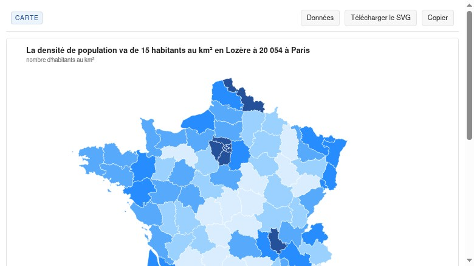
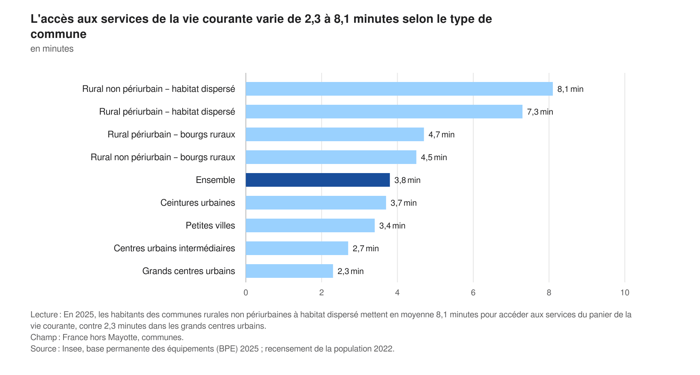
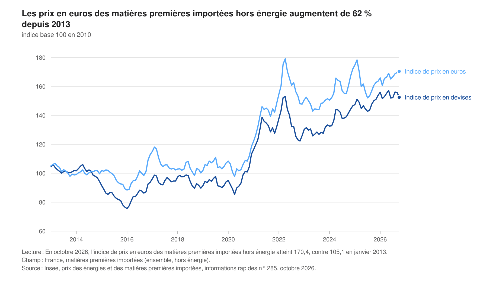

# Insee figures — an MCP app that keeps an LLM inside Insee's visual grammar

**Three figure forms, one editorial contract, zero chart junk — rendered server-side so the model cannot improvise.**



Ask a general-purpose LLM for "a chart" and you get a gradient donut with a
truncated axis. Insee publishes **three forms and nothing else**, each wrapped in
the same editorial block (`Lecture / Champ / Source`). This MCP server encodes
that grammar: it picks the form from the shape of the data, validates the
metadata, and renders deterministic SVG. The model chooses nothing visual — it
fills a typed contract.

Built as a prototype against real Insee publications, on FastMCP 4 and the MCP
Apps extension.

## What it does

| Data shape | Figure | Tool |
|---|---|---|
| one indicator + official geographic code | choropleth map, quantile classes or the publication's own thresholds | `render_map` |
| one indicator + category | horizontal ranked bars, value printed at the bar end | `render_bars` |
| one indicator + period | line chart, time-proportional axis, direct end labels | `render_line` |
| two numerics, one row, a pie chart request | refused, with the reason and the alternative | `recommend_chart` |

Every figure carries a title that states a result, the unit under the title, and
a footer in Insee's order: `Lecture :` (one sentence with a value), `Champ :`
(geographic field and population), `Source :` (producer + operation + vintage).
French typography is enforced by code: narrow no-break space as thousands
separator, comma decimal, no trailing zero on axis labels.

## Showcase — three prompts, three figures

The screenshots below are the actual output of `examples/make_demo.py`, built
from the Insee data files shipped in `examples/data/`.

### 1. A map, with the publication's own class breaks


**Prompt**

> Cartographie la densité de population par département en 2022, avec les seuils
> de l'Insee (50, 75, 150 et 300 habitants au km²).

**What happens**

1. `recommend_chart` sees a geography column and returns *carte choroplèthe* —
   plus the warning that a map must show a rate, a density or a share, never a
   raw count.
2. The model calls
   `render_map(rows=…, level="departement", thresholds=[50, 75, 150, 300], decimals=0)`.
3. The tool answers:
   `Map ready — 96 territories, 5 classes, values from 15 to 20 054.`

**Why it looks like that**: Insee prints fixed thresholds for skewed variables
rather than quintiles, so the API accepts them; the legend labels the classes
(`Moins de 50`, `De 50 à moins de 75`, …, `300 et plus`) instead of showing bare
boundary ticks; missing territories are grey; the projection is Lambert-93, not
equirectangular.

### 2. Bars, ranked, with the average called out



**Prompt**

> La figure Insee des temps d'accès moyens aux services de la vie courante selon
> le type de commune (BPE 2025), avec la moyenne France mise en avant.

**What happens**

`render_bars(sort="desc", highlight="Ensemble", value_suffix="min", decimals=1)`
— nine categories, the average in dark blue against light-blue peers, value at
the bar end, labels wrapped at 40 characters so nothing is truncated.

**The figure says something**: the longest bar is not a city. Residents of
dispersed non-periurban rural communes spend 8.1 minutes on average reaching the
everyday-services basket, against 2.3 minutes in large urban centres.

### 3. A line, with two series and no false axis drama



**Prompt**

> Trace l'évolution des indices de prix des matières premières importées hors
> énergie depuis 2013, en euros et en devises.

**What happens**

`render_line(series=…, decimals=0)` — a time-proportional x axis, horizontal
gridlines only, each line labelled at its right end (the right margin is computed
from the longest label, so it never runs off the canvas), a marker on the last
known point, and a hole in the data breaks the line instead of interpolating it.

## What it refuses

The guide is as much a filter as a renderer. Real responses from
`recommend_chart`:

> **Hors périmètre.** Deux variables numériques appellent un nuage de points, que
> ce prototype ne produit pas. Renvoyer un tableau trié, ou demander une
> agrégation (moyenne par catégorie) pour passer en barres.

> **Pas de camembert** : Insee n'en publie pas. Des barres classées montrent les
> mêmes parts et se comparent exactement ; garder le cercle uniquement si le
> client l'exige explicitement.

And `render_bars` refuses to draw an unreadable wall of bars:

```
20 categories: aggregate to the 12 largest plus 'Autres' before drawing;
an Insee bar figure stays readable at a glance.
```

A figure can be rendered with incomplete metadata, but never silently: missing
`unit`, `lecture` or `champ` come back as warnings in the tool result and in the
viewer, so the model is pushed to finish the editorial block.

```
Warnings: meta.unit is missing: Insee prints the unit under the title ('en %',
'en minutes', 'indice base 100 en 2010'). meta.lecture is missing: add one
factual sentence with a value, e.g. 'En 2025, les habitants ... mettent en
moyenne 8,1 minutes ...'.
```

## Tools

| Tool | Arguments | Purpose |
|---|---|---|
| `recommend_chart` | `columns[{name,kind,distinct,example}]`, `row_count`, `goal?` | Chooses the form, returns the parameter contract and the pitfalls |
| `render_map` | `rows[{code,value,name?}]`, `meta`, `level`, `classes`, `method`, `thresholds`, `decimals`, `value_suffix` | Choropleth of France (départements or régions) |
| `render_bars` | `rows[{label,value,series?}]`, `meta`, `orientation`, `sort`, `highlight`, `show_values`, `decimals`, `value_suffix` | Single series or 2–3 grouped series |
| `render_line` | `series[{label,points[{x,y}]}]`, `meta`, `y_zero`, `y_min/y_max`, `reference`, `end_labels` | 1–4 dated series |

`meta` is `FigureMeta`: `title` and `source` required, `unit` strongly expected,
`lecture`/`champ` recommended, optional `number` (`Figure 2 – …`) and `brand`.

Two resources:

- `insee://doctrine/figures` — the full doctrine: routing table, bans, editorial
  block, typography.
- `ui://insee-viz/view.html` — the MCP App viewer (figure, data table, SVG
  download, warnings).

And a prompt, `figure_insee(donnees, objectif?)`, that wraps the whole workflow
for hosts that surface prompts.

## Install and run

Requires Python 3.11+ and [uv](https://docs.astral.sh/uv/).

```bash
git clone https://github.com/Mirlon382/insee-viz-mcp.git
cd insee-viz-mcp
uv sync
```

Build the three demo figures (writes SVG + PNG + `gallery.html`):

```bash
.venv/bin/python examples/make_demo.py
```

Run the server over stdio, which is what MCP clients expect:

```bash
.venv/bin/insee-viz-mcp          # console script, no banner on stdout
# or
.venv/bin/fastmcp run server.py:mcp
```

Over HTTP, for the inspector or a remote client:

```bash
.venv/bin/fastmcp run server.py:mcp --transport http --port 8765
# endpoint: http://127.0.0.1:8765/mcp
```

Check what the server exposes without starting a session:

```bash
.venv/bin/fastmcp inspect server.py:mcp
```

### Register in Hermes

```bash
hermes mcp add insee-viz --command "$HOME/projects/insee-viz-mcp/.venv/bin/insee-viz-mcp"
```

Then `/reload-mcp now` in an open session, or start a new one. The tools appear
as `mcp_insee_viz_*`.

### Register in another MCP client

```json
{
  "mcpServers": {
    "insee-viz": {
      "command": "/absolute/path/to/insee-viz-mcp/.venv/bin/insee-viz-mcp",
      "args": []
    }
  }
}
```

## How it works

```
LLM ──recommend_chart──▶ form + contract
 │                             │
 └──render_map / bars / line───┘
            │
            ▼
   pydantic validation ──▶ deterministic SVG renderer ──▶ SVG + PNG files
                                       │
                                       └──▶ structuredContent ──▶ MCP App viewer
```

The ordering matters: routing runs before any drawing, so the model cannot pick
a chart type by taste; and rendering is pure Python, so the same input always
produces the same bytes. The SVG is placed in `structuredContent` **only when
the client declared the MCP Apps extension** (`ctx.client_supports_extension`) —
a 180 KB map never lands in a text-only model's context; that client still gets
the file paths and the summary.

The renderers share one style module (canvas size, palette sampled from Insee
publications, gridlines, typography) and one layout toolkit (header, wrapped
notes, escaping). Adding a figure form means adding a renderer, not a prompt.

## Data shipped with the demo

| File | Source |
|---|---|
| `examples/data/densite_departements_2022.json` | [Insee, recensement de la population 2022](https://www.insee.fr/fr/statistiques/8612514), densité par département, with the publication's class breaks |
| `examples/data/temps_acces_services.json` | [Insee Première n° 2136](https://www.insee.fr/fr/statistiques/9129562), figure 1 (BPE 2025) |
| `examples/data/matieres_premieres.json` | [Insee, Informations rapides n° 285](https://www.insee.fr/fr/statistiques/9148431), octobre 2026, monthly series 2013-2026 |

Contours: [france-geojson](https://github.com/gregoiredavid/france-geojson)
(simplified départements/régions, derived from IGN ADMIN-EXPRESS, licence
ouverte).

## Tests

```bash
.venv/bin/python -m pytest
```

19 tests, all executed before this README was written. They assert:

- the editorial contract: a figure without a `source` fails validation, a title
  never ends with a period, French number formatting (`1 813 800`, `45,8`);
- the rendered SVG: one bar per category, breaks in a series produce a second
  path, every département is drawn, legend ranges are human-readable, thresholds
  must match the class count;
- the MCP surface through a real client: the four tools are published, `ctx` is
  not leaked into the input schema, the app resource is readable, the SVG is
  withheld from a client without the extension, missing metadata is reported as
  warnings, >14 categories raise a `ToolError` with the aggregation advice;
- routing: geography → map, date → line, category → bars, one row → no figure,
  two numerics → out of scope.

## Layout

```
server.py                     # two-line shim so `fastmcp run server.py:mcp` works
src/insee_viz_mcp/
  server.py                   # tools, guide, resources, app wiring
  models.py                   # the typed contract (FigureMeta, BarSpec, …)
  style.py                    # palette, typography, French number formatting
  svgkit.py                   # SVG primitives, header, notes block
  geo.py                      # Lambert-93 projection, bundled contours
  charts/{bars,line,choropleth}.py
  data/{guide.md,view.html,*.geojson}
examples/make_demo.py         # the three figures above
tests/
docs/                         # screenshots used by this README
```

## Limits (deliberate, prototype scope)

- Metropolitan France only for maps: no overseas insets, no commune-level
  geometry.
- No scatter plot, no stacked bars; at most 3 grouped series and 4 lines.
- The viewer loads the MCP Apps SDK from unpkg (declared in the resource CSP).
  A host without the extension gets file paths and a text summary, not the
  iframe.
- Files are written to `~/.cache/insee-viz/` (`INSEE_VIZ_OUT` to change); there
  is no cleanup policy yet.
- No authentication: this is a local stdio/HTTP prototype, not a service.
