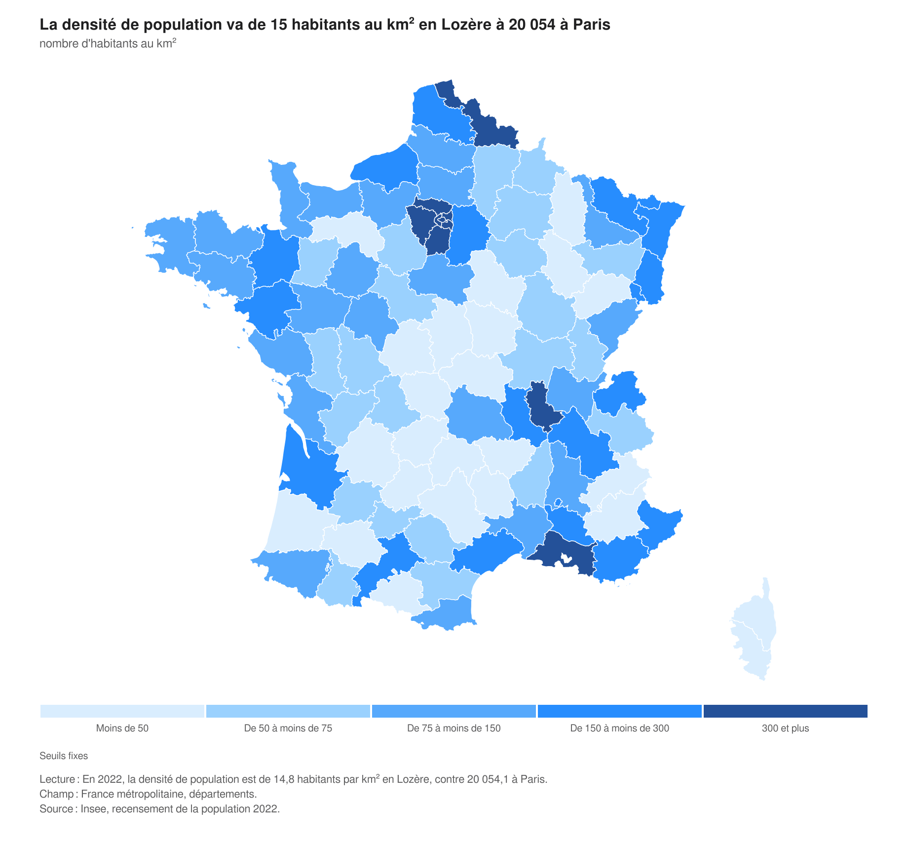

# Insee figures — an MCP app that keeps an LLM inside Insee's visual grammar

**Three figure forms, one editorial contract, zero chart junk — rendered server-side so the model cannot improvise.**

[](https://github.com/Mirlon382/insee-viz-mcp/actions/workflows/ci.yml)
[](https://hub.docker.com/r/mirlon382/insee-viz-mcp)
[](LICENSE)


Ask a general-purpose LLM for "a chart" and you get a gradient donut with a
truncated axis. Insee publishes **three forms and nothing else**, each wrapped in
the same editorial block (`Lecture / Champ / Source`). This MCP server encodes
that grammar: it picks the form from the shape of the data, validates the
metadata, and renders deterministic SVG. The model chooses nothing visual — it
fills a typed contract.

**Unofficial.** This is not an Insee product and carries no endorsement: the figures imitate
Insee's published grammar, and the optional `meta.brand` wordmark exists only for reproducing a
figure Insee itself published.

Built on FastMCP 4 and the MCP Apps extension, laid out the way
[McpSquelette](https://github.com/Mirlon382/McpSquelette) lays out a server:
settings, logging, lifespan, error contract, middlewares, both transports, a
container image and the Kubernetes manifests are infrastructure, and `tools/`
holds only the figure logic.

## What it does

| Data shape | Figure | Tool |
|---|---|---|
| one indicator + official geographic code | choropleth map, quantile classes or the publication's own thresholds | `render_map` |
| one indicator + category | horizontal ranked bars, value printed at the bar end | `render_bars` |
| one indicator + period | line chart, time-proportional axis, direct end labels | `render_line` |
| two numerics, one row, a pie chart request | refused, with the reason and the alternative | `recommend_chart` |

Every figure carries a title that states a result, the unit under the title, and
a footer in Insee's order: `Lecture :` (one sentence with a value), `Champ :`
(geographic field and population), `Source :` (producer + operation + vintage).
French typography is enforced by code: narrow no-break space as thousands
separator, comma decimal, no trailing zero on axis labels.

## Showcase — three prompts, three figures

The screenshots below are the actual output of `examples/make_demo.py`, built
from the Insee data files shipped in `examples/data/`.

### 1. A map, with the publication's own class breaks



**Prompt**

> Cartographie la densité de population par département en 2022, avec les seuils
> de l'Insee (50, 75, 150 et 300 habitants au km²).

**What happens**

1. `recommend_chart` sees a geography column and returns *carte choroplèthe* —
   plus the warning that a map must show a rate, a density or a share, never a
   raw count.
2. The model calls
   `render_map(rows=…, level="departement", thresholds=[50, 75, 150, 300], decimals=0)`.
3. The tool answers:
   `Map ready — 96 territories, 5 classes, values from 15 to 20 054.`

**Why it looks like that**: Insee prints fixed thresholds for skewed variables
rather than quintiles, so the API accepts them; the legend labels the classes
(`Moins de 50`, `De 50 à moins de 75`, …, `300 et plus`) instead of showing bare
boundary ticks; missing territories are grey; the projection is Lambert-93, not
equirectangular.

### 2. Bars, ranked, with the average called out


**Prompt**

> La figure Insee des temps d'accès moyens aux services de la vie courante selon
> le type de commune (BPE 2025), avec la moyenne France mise en avant.

**What happens**

`render_bars(sort="desc", highlight="Ensemble", value_suffix="min", decimals=1)`
— nine categories, the average in dark blue against light-blue peers, value at
the bar end, labels wrapped at 40 characters so nothing is truncated.

**The figure says something**: the longest bar is not a city. Residents of
dispersed non-periurban rural communes spend 8.1 minutes on average reaching the
everyday-services basket, against 2.3 minutes in large urban centres.

### 3. A line, with two series and no false axis drama


**Prompt**

> Trace l'évolution des indices de prix des matières premières importées hors
> énergie depuis 2013, en euros et en devises.

**What happens**

`render_line(series=…, decimals=0)` — a time-proportional x axis, horizontal
gridlines only, each line labelled at its right end (the right margin is computed
from the longest label, so it never runs off the canvas), a marker on the last
known point, and a hole in the data breaks the line instead of interpolating it.

## What it refuses

The guide is as much a filter as a renderer. Real responses from
`recommend_chart`:

> **Hors périmètre.** Deux variables numériques appellent un nuage de points, que
> ce prototype ne produit pas. Renvoyer un tableau trié, ou demander une
> agrégation (moyenne par catégorie) pour passer en barres.

> **Pas de camembert** : Insee n'en publie pas. Des barres classées montrent les
> mêmes parts et se comparent exactement ; garder le cercle uniquement si le
> client l'exige explicitement.

And `render_bars` refuses to draw an unreadable wall of bars — a refusal the
caller can act on, so it carries an error code:

```
[INVALID_QUERY] 20 categories: aggregate to the 12 largest plus 'Autres' before
drawing; an Insee bar figure stays readable at a glance.
```

A figure can be rendered with incomplete metadata, but never silently: missing
`unit`, `lecture` or `champ` come back as warnings in the tool result and in the
viewer, so the model is pushed to finish the editorial block.

```
Warnings: meta.unit is missing: Insee prints the unit under the title ('en %',
'en minutes', 'indice base 100 en 2010'). meta.lecture is missing: add one
factual sentence with a value, e.g. 'En 2025, les habitants ... mettent en
moyenne 8,1 minutes ...'.
```

## Tools

| Tool | Arguments | Purpose |
|---|---|---|
| `recommend_chart` | `columns[{name,kind,distinct,example}]`, `row_count`, `goal?` | Chooses the form, returns the parameter contract and the pitfalls |
| `render_map` | `rows[{code,value,name?}]`, `meta`, `level`, `classes`, `method`, `thresholds`, `decimals`, `value_suffix` | Choropleth of France (départements or régions) |
| `render_bars` | `rows[{label,value,series?}]`, `meta`, `orientation`, `sort`, `highlight`, `show_values`, `decimals`, `value_suffix` | Single series or 2–3 grouped series |
| `render_line` | `series[{label,points[{x,y}]}]`, `meta`, `y_zero`, `y_min/y_max`, `reference`, `end_labels` | 1–4 dated series |

`meta` is `FigureMeta`: `title` and `source` required, `unit` strongly expected,
`lecture`/`champ` recommended, optional `number` (`Figure 2 – …`) and `brand`.

All four are registered `READ_ONLY` — they answer from their arguments, and the
same call always yields the same figure. The three render tools also declare the
MCP App resource, which is what lets a host render the viewer beside the answer.

Two resources:

- `insee://doctrine/figures` — the full doctrine: routing table, bans, editorial
  block, typography.
- `ui://insee-viz/view.html` — the MCP App viewer (figure, data table, SVG
  download, warnings).

And a prompt, `figure_insee(donnees, objectif?)`, that wraps the whole workflow
for hosts that surface prompts.

## Install and run

Requires Python 3.12+ and [uv](https://docs.astral.sh/uv/).

```bash
git clone https://github.com/Mirlon382/insee-viz-mcp.git
cd insee-viz-mcp
uv sync
```

Build the three demo figures (writes SVG + PNG + `gallery.html`):

```bash
uv run python examples/make_demo.py
```

Run the server — Streamable HTTP on `POST /mcp`, which is what this application
is:

```bash
uv run insee-viz-mcp
# endpoint: http://127.0.0.1:8000/mcp   (MCP_HOST / MCP_PORT to move it)
```

For a client that launches the process itself (Claude Desktop, an editor that
only speaks stdio), opt out of HTTP:

```bash
MCP_TRANSPORT=stdio uv run insee-viz-mcp
```

To keep it up on a Linux desktop, `deploy/systemd/insee-viz-mcp.service` binds
`127.0.0.1:8000` and restarts on failure:

```bash
cp deploy/systemd/insee-viz-mcp.service ~/.config/systemd/user/
systemctl --user daemon-reload
systemctl --user enable --now insee-viz-mcp
```

Check what the server exposes without starting a session:

```bash
uv run fastmcp inspect insee_viz_mcp.server:mcp
```

### Register in Hermes

With the server running (the unit above, or `uv run insee-viz-mcp`), register the
URL:

```bash
hermes mcp add insee-viz --url http://127.0.0.1:8000/mcp
```

Then `/reload-mcp now` in an open session, or start a new one. The tools appear
as `mcp_insee_viz_*`.

### Register in another MCP client

A client that speaks Streamable HTTP takes the URL, and needs the server running:

```json
{
  "mcpServers": {
    "insee-viz": {
      "type": "http",
      "url": "http://127.0.0.1:8000/mcp"
    }
  }
}
```

A client that can only launch a process gets the stdio form — the transport is the
only difference, the tools are the same:

```json
{
  "mcpServers": {
    "insee-viz": {
      "command": "/absolute/path/to/insee-viz-mcp/.venv/bin/insee-viz-mcp",
      "args": [],
      "env": { "MCP_TRANSPORT": "stdio" }
    }
  }
}
```

## Container

The image serves Streamable HTTP on port 8000, runs as the non-root user `app`
(uid 1000), writes rendered figures to `/data` — a declared volume, so you can
bind or mount it — and carries `rsvg-convert` so the PNG twin of each figure is
produced too.

**podman (rootless)**

```bash
podman build --format docker -t insee-viz-mcp .
podman run --rm -p 8000:8000 -e ALLOWED_HOSTS='["localhost"]' insee-viz-mcp
```

`--format docker` matters: podman's default OCI format **drops `HEALTHCHECK`**
and warns, so the container would run with no health status at all. With the
docker format the probe survives:
`podman inspect --format '{{.State.Health.Status}}' <container>` answers
`starting`, then `healthy` about twenty seconds in.

**docker**

```bash
docker build -t insee-viz-mcp .
docker run --rm -p 8000:8000 -e ALLOWED_HOSTS='["localhost"]' insee-viz-mcp
```

Verify it without a client — the endpoint is reachable and the tool set is
published:

```bash
curl -s -X POST http://localhost:8000/mcp \
  -H 'Content-Type: application/json' \
  -H 'Accept: application/json, text/event-stream' \
  -d '{"jsonrpc":"2.0","id":1,"method":"initialize","params":{"protocolVersion":"2025-06-18","capabilities":{},"clientInfo":{"name":"curl","version":"0"}}}'
```

The image builds with `uv sync --locked`, so `uv.lock` must be current (`uv lock`
after changing dependencies). Its healthcheck opens a TCP connection rather than
making an HTTP request: the MCP endpoint answers `400` without a session
handshake, so an HTTP probe would fail on a healthy server.

**Kubernetes**

`k8s/manifest.yaml` contains the Service, the Deployment and the Ingress. Edit the
namespace, the image and the hostname, then:

```bash
kubectl apply -f k8s/manifest.yaml
```

Two values are not optional once you are behind an Ingress:

- `ALLOWED_HOSTS` must contain the hostname the Ingress routes, or host protection
  returns `421` to every request.
- `TRUSTED_PROXY_HOSTS` must include the Ingress controller (the manifest uses
  `["*"]`, safe only because the pod is reachable exclusively through the
  Ingress). Without it, uvicorn sees every request coming from the Ingress and
  rate-limits all your users as one caller.

The Deployment runs the container with `readOnlyRootFilesystem: true` — the
application writes nothing outside `/data` — which is why `/data` is an
`emptyDir` (256 Mi, pod-level `fsGroup: 1000` so uid 1000 can write). Treat it as
scratch, not storage: it survives a container restart inside the pod and is lost
when the pod is rescheduled, nothing serves the directory over HTTP (an MCP App
client receives the SVG inline in `structuredContent`), and there is no cleanup
policy, hence the size limit. Swap it for a PersistentVolumeClaim if you want the
files kept — and keep `fsGroup: 1000`, or the first render fails with
`[INTERNAL_ERROR] … not writable`.

## How it works

```
LLM ──recommend_chart──▶ form + contract
 │                             │
 └──render_map / bars / line───┘
            │
            ▼
   pydantic validation ──▶ deterministic SVG renderer ──▶ SVG + PNG files
                                       │
                                       └──▶ structuredContent ──▶ MCP App viewer
```

The ordering matters: routing runs before any drawing, so the model cannot pick
a chart type by taste; and rendering is pure Python, so the same input always
produces the same bytes. The SVG is placed in `structuredContent` **only when
the client declared the MCP Apps extension** — a 180 KB map never lands in a
text-only model's context; that client still gets the file paths and the summary.

The request passes through the same four middlewares as every McpSquelette
server, in this order:

```
client → Host/Origin check → ErrorHandling → RateLimit → Timing → Logging → your tool
```

`ErrorHandling` comes first so it sees the whole chain: an `AppToolError` message
reaches the caller verbatim, code included, while any other exception is replaced
by a generic message and logged in full server-side. `RateLimit` is keyed on the
caller's address, believing `X-Forwarded-For` only from `TRUSTED_PROXY_HOSTS`.

The renderers share one style module (canvas size, palette sampled from Insee
publications, gridlines, typography) and one layout toolkit (header, wrapped
notes, escaping). Adding a figure form means adding a renderer, not a prompt.

## Data shipped with the demo

| File | Source |
|---|---|
| `examples/data/densite_departements_2022.json` | [Insee, recensement de la population 2022](https://www.insee.fr/fr/statistiques/8612514), densité par département, with the publication's class breaks |
| `examples/data/temps_acces_services.json` | [Insee Première n° 2136](https://www.insee.fr/fr/statistiques/9129562), figure 1 (BPE 2025) |
| `examples/data/matieres_premieres.json` | [Insee, Informations rapides n° 285](https://www.insee.fr/fr/statistiques/9148431), octobre 2026, monthly series 2013-2026 |

Contours: [france-geojson](https://github.com/gregoiredavid/france-geojson)
(simplified départements/régions, derived from IGN ADMIN-EXPRESS, licence
ouverte).

## Tests

```bash
uv run pytest -q
uv run ruff check . && uv run ruff format --check .
```

31 tests, all green before this README was written. They assert:

- the editorial contract: a figure without a `source` fails validation, a title
  never ends with a period, French number formatting (`1 813 800`, `45,8`);
- the rendered SVG: one bar per category, breaks in a series produce a second
  path, every département is drawn, legend ranges are human-readable, thresholds
  must match the class count;
- the MCP surface through a real client (`fastmcp.Client`, not a direct call):
  the four tools are registered and annotated read-only, no `Depends` parameter
  leaks into an input schema, the viewer and the doctrine are readable, the
  prompt is listed, the SVG is withheld from a client without the extension,
  missing metadata is reported as warnings, >14 categories answers
  `[INVALID_QUERY]` with the aggregation advice, and an empty `rows` answers
  `[INVALID_INPUT]` naming the field;
- the publisher: `tmp_path` output, the slug, a failing rasteriser that keeps the
  SVG instead of losing the figure, and an unwritable output directory reported as
  `[INTERNAL_ERROR]` with the setting to change;
- both transports: `http` is the default and answers an `initialize` through the
  ASGI app, `MCP_TRANSPORT=stdio` answers the same handshake on a subprocess's
  pipes;
- routing: geography → map, date → line, category → bars, one row → no figure,
  two numerics → out of scope.

CI runs the same gates on Python 3.12 and 3.13, then builds the image, waits for
its healthcheck and draws a figure inside the container.

## Layout

```
.env.example                  # every variable, documented — copy to .env
LICENSE                       # MIT
SECURITY.md                   # what this server does and does not protect
.dockerignore                 # keeps the build context to what the image needs
.github/workflows/ci.yml      # ruff + pytest on 3.12/3.13, then the image healthcheck
.pre-commit-config.yaml       # ruff on every commit
Dockerfile                    # multi-stage, non-root, /data volume, healthcheck
k8s/manifest.yaml             # Service + Deployment + Ingress
pyproject.toml                # deps, console script, ruff + pytest config
deploy/systemd/               # user unit for a long-running HTTP server on Linux
src/insee_viz_mcp/
  server.py                   # entrypoint: settings, lifespan, middlewares, transports
  settings.py                 # every configurable value
  logging.py                  # log format and level
  lifespan.py                 # the publisher and the contour cache, opened once
  errors/                     # AppToolError + ErrorCode
  models/                     # figures.py (the contract), routing.py, results.py
  tools/
    __init__.py               # the single registration point
    guidance/tools.py         # recommend_chart
    figures/{map,bars,line}.py  # the three render tools, one form per module
    figures/common.py         # warnings, refusals, the ToolResult shape
  resources/                  # doctrine + app viewer + their URIs
  prompts/figure.py           # the prepared workflow
  utils/                      # publish.py (files + rasteriser), apps.py, client_host.py
  charts/{bars,line,choropleth}.py   # the renderers
  style.py                    # palette, typography, French number formatting
  svgkit.py                   # SVG primitives, header, notes block
  geo.py                      # Lambert-93 projection, bundled contours
  data/{guide.md,view.html,*.geojson}
examples/make_demo.py         # the three figures above
tests/                        # speak the real protocol; conftest points the output at tmp_path
docs/                         # screenshots used by this README
```

Adding a tool follows the skeleton's rule: models in `models/`, the function in
`tools/<name>/tools.py`, the test in `tests/`, and one line in
`tools/__init__.py`. Registration lives only there — an unregistered tool is the
only "disabled" the protocol guarantees.

## Licence and attribution

The code is **MIT** — see [LICENSE](LICENSE).

It ships third-party material, and a public copy has to say so:

| What | Source | Licence |
|---|---|---|
| `departements.geojson`, `regions.geojson` | [france-geojson](https://github.com/gregoiredavid/france-geojson), derived from IGN ADMIN-EXPRESS (simplified shapes) | Licence Ouverte 2.0 (Etalab) — attribution required |
| `examples/data/*.json` and the numbers in `docs/*.png` | Insee — each file names its publication | Licence Ouverte 2.0 — attribution required |
| `docs/app-view.png`, the figure screenshots | output of this server, over the data above | as the data above |

Every rendered figure carries its `Source :` line by design, which is what the Insee licence asks of
a reuse. No Insee or IGN logo is bundled, and nothing here implies endorsement: see the disclaimer at
the top.

## Limits (deliberate, prototype scope)

- Metropolitan France only for maps: no overseas insets, no commune-level
  geometry.
- No scatter plot, no stacked bars; at most 3 grouped series and 4 lines.
- The viewer loads the MCP Apps SDK from unpkg (declared in the resource CSP).
  A host without the extension gets file paths and a text summary, not the
  iframe.
- Files are written to `~/.cache/insee-viz/` inside the container to `/data`;
  `INSEE_VIZ_OUT` changes it, and there is no cleanup policy yet.
- No authentication: the host/origin check and the rate limiter are the only
  guards. Put it behind a gateway before exposing it.
